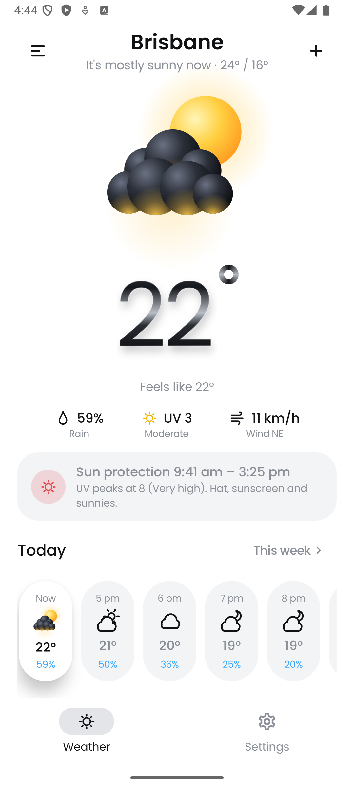
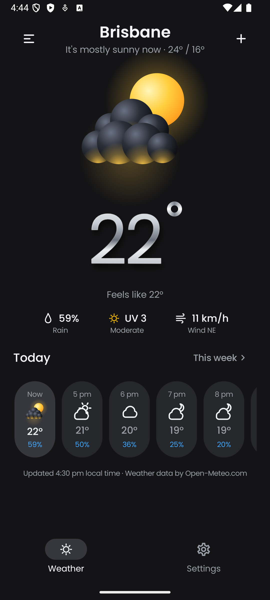
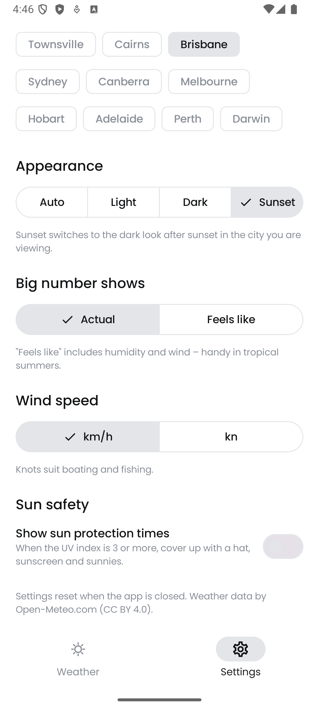

# Southerly — Australian weather at a glance

Southerly is a utility-style Android app built for **CP3406/CP5307 Assessment 1: Utility App**,
developed on top of the subject's starter template (Jetpack Compose + Material 3).
It answers the three questions most Australians ask before heading out:
**How hot is it? Will it rain? Do I need sun protection?** Everything important fits on one
screen, with a 3D "clay" weather illustration and a liquid-chrome temperature as the focal point.

---

## Screenshots

| Light | Dark | Settings |
|---|---|---|
|  |  |  |

---

## Getting Started

1. Clone or download this repo.
2. Open it in Android Studio and let Gradle sync.
3. Run on an emulator or device with API 26+ and internet access.
4. Run unit tests: right-click `app/src/test` → *Run 'Tests in app'* (or `./gradlew test`).

---

## Core features

| Feature | What the user sees | How it is implemented |
|---|---|---|
| At-a-glance hero | Animated 3D weather drawing + large chrome temperature | `WeatherIllustration` draws spheres, drops, bolt, moon and stars with Compose `Canvas` and `rememberInfiniteTransition`; `ChromeTemperature` layers gradient-brush text, a stroke outline and a blurred shadow |
| Three key numbers | Rain chance, UV index (colour-coded), wind speed + direction | `StatRow`; UV categories in `UvLevel` follow the WHO scale used by BOM / Cancer Council |
| Sun protection times | "Sun protection 8:10 am – 3:50 pm, UV peaks at 12 (Extreme)" | `SunProtectionCalculator` finds when hourly UV is ≥ 3 and interpolates the exact minutes |
| Today / This week | Hourly pills (next 24 h) or 7-day pills, toggled with "This week ›" | `ForecastSection` with `LazyRow` + `AnimatedContent` |
| Quick city switch | ≡ menu lists saved cities; + opens Settings | `DropdownMenu` in `WeatherHeader` |
| Pull to refresh | Swipe down to reload | Material 3 `PullToRefreshBox` |
| Settings (affect main screen) | City search + quick picks, theme (Auto / Light / Dark / Sunset), big number (Actual / Feels like), wind units (km/h / knots), sun protection card on/off | `SettingsScreen` (stateless) → `WeatherViewModel.updateSettings` |
| Australian localisation | 12-hour times, °C, km/h or knots, state codes (QLD, NSW…), local time zone per city (QLD has no daylight saving) | `Format.kt`, `AustralianCities`, Open-Meteo `timezone=auto` |
| Accessibility | Every icon and pill has a spoken description | `clearAndSetSemantics` / `contentDescription` |

---

## Composables (starter template names kept)

### UtilityApp() — `MainActivity.kt`
- Scaffold with the template's bottom navigation (Weather / Settings)
- Shares one `WeatherViewModel` between both screens and decides light/dark theme from Settings

### UtilityScreen() — `screen/utility_screen.kt`
- The at-a-glance weather screen (loading, error and success states, four `@Preview`s)

### SettingsScreen() — `screen/settings_screen.kt`
- City search, quick picks, theme, big-number, wind-unit and sun-protection options
- Every option changes the main screen immediately

---

## Architecture

```
UI (Jetpack Compose)          UtilityApp ─┬─ UtilityScreen  (stateless)
                                          └─ SettingsScreen (stateless)
                                   │ StateFlow ↑   ↓ events
ViewModel                      WeatherViewModel  (survives rotation)
                                   │ suspend calls
Repository                     WeatherRepository (interface)
                                   └─ NetworkWeatherRepository
Network (Retrofit)             ForecastApiService · GeocodingApiService
Dependency injection           AppContainer (created in SoutherlyApplication)
```

* **Unidirectional data flow** — screens receive state and send events; only the ViewModel changes state.
* **Repository pattern** — the ViewModel depends on the `WeatherRepository` interface, so tests use a fake.
* **Manual DI** — `DefaultAppContainer` builds Retrofit/OkHttp once; `WeatherViewModel.Factory` reads it via `APPLICATION_KEY`.
* **DTO → model mapping** — `ForecastMapper.kt` turns raw JSON classes into clean model classes.
* **Settings are in memory** (the brief says they need not persist).

## Key concepts covered

| Week | Concept | Used in |
|------|---------|---------|
| 1 | Kotlin + Android Studio | Whole project |
| 2 | Jetpack Compose layouts | `UtilityApp()`, `UtilityScreen()`, `SettingsScreen()`, `ui/components` |
| 3 | Material Design 3 | `SoutherlyTheme`, `SoutherlyTypography`, `NavigationBar`, `SegmentedButton`, `PullToRefreshBox` |
| 4 | ViewModel, repository, manual DI | `WeatherViewModel`, `WeatherRepository`, `AppContainer` |
| 5 | Retrofit | `ForecastApiService`, `GeocodingApiService` with kotlinx.serialization |

## APIs used

* Open-Meteo Forecast API — `https://api.open-meteo.com/v1/forecast` (current, hourly, daily, `timezone=auto`)
* Open-Meteo Geocoding API — `https://geocoding-api.open-meteo.com/v1/search` (filtered to Australia)

No API key is needed. Weather data by [Open-Meteo.com](https://open-meteo.com/) (CC BY 4.0).

## Project structure

```
app/src/main/java/au/edu/jcu/assessment/utilityapp/
├── MainActivity.kt      MainActivity + UtilityApp() scaffold
├── SoutherlyApplication.kt
├── api/                 Retrofit services + DTOs (ForecastApiService, GeocodingApiService, Dtos)
├── data/                AppContainer, WeatherRepository, ForecastMapper
├── model/               City, Forecast, WeatherCondition, UvLevel, SunProtection, Settings
├── screen/              utility_screen.kt, settings_screen.kt
├── viewmodel/           WeatherViewModel
└── ui/                  Format.kt
    ├── components/      WeatherIllustration, ChromeTemperature, Glyphs, StatRow, SunProtectionCard, ForecastStrip
    ├── theme/           SoutherlyColor, SoutherlyType (Poppins), SoutherlyTheme
    └── preview/         SampleData for @Preview and tests
app/src/test/            Unit tests for the model, mapper and ViewModel
```

The starter template's original example files (`CounterViewModel`, `QuoteViewModel`, `QuoteApi`
and the default theme files) are kept in the repository for reference.

## Author

Kei Kwan IP — 14451330, CP3406 2026

## Credits

* Built on the CP3406 Utility App starter template.
* Visual direction inspired by a weather-app concept by QINGMANG DESIGN (layout and 3D clay style);
  all illustrations in this app are drawn in code, no images from that concept are used.
* Poppins typeface — Indian Type Foundry, SIL Open Font License 1.1.
* Generative AI was used during development — see the Declaration of AI-Generated Material submitted with this assignment.